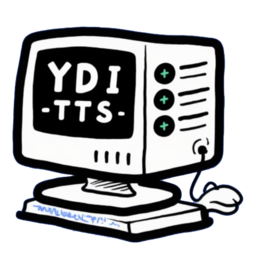
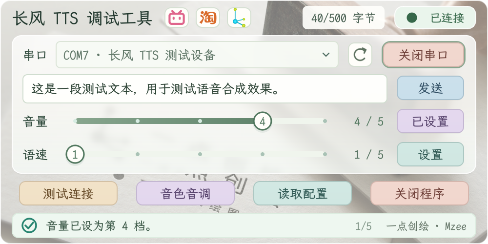
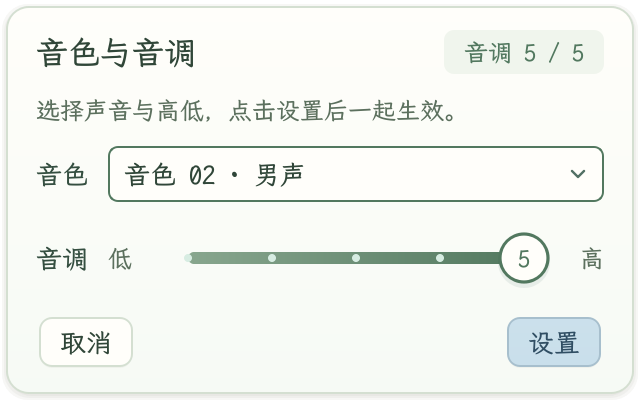
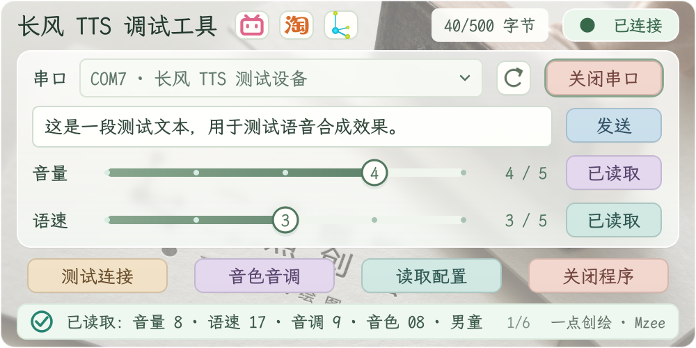

<div align="center">
  
  <h1>长风 TTS</h1>
  <p>轻巧的串口语音合成调试工具 · 输入文字，调好声音，一键播报</p>
  <p>
    <a href="https://github.com/Cans518/YDI_TTS/actions/workflows/build.yml"></a>
    
    
    
    <a href="LICENSE"></a>
  </p>
  <p>
    <a href="https://github.com/Cans518/YDI_TTS/releases/latest">下载应用</a> ·
    <a href="#界面预览">界面预览</a> ·
    <a href="#快速上手">快速上手</a> ·
    <a href="#开发与构建">开发与构建</a> ·
    <a href="https://github.com/Cans518/YDI_TTS/issues">反馈问题</a>
  </p>
</div>

长风 TTS 是面向长风 TTS 串口模块的桌面调试工具，基于 **Qt 6 Widgets 与 C++17** 开发。连接模块后，即可发送中文文本、试听不同音色、调整声音参数和读取模块配置，适合语音播报项目的开发与调试。

## 功能亮点

- 🔊 **文字播报**：输入文本即可发送，实时显示字节数，支持回车快捷播报。
- 🎚️ **声音调节**：五档音量、语速和音调，搭配八种音色，覆盖男声、女声、童声与特殊音色。
- 🔌 **设备连接**：自动检测串口插拔，支持手动刷新与连接测试。
- 📥 **配置读取**：一键查看模块当前音量、语速、音色和音调。
- ✨ **轻巧界面**：500 × 250 紧凑窗口，浅色玻璃面板、霞鹜文楷字体与柔和动画。
- 🖥️ **跨平台**：支持 Windows、Linux 与 macOS，Windows 提供单文件便携版。

## 界面预览

<p align="center">
  
  <br><em>主窗口 · 文本播报与声音调节</em>
</p>

<table>
  <tr>
    <th width="42%">音色与音调</th>
    <th width="58%">读取模块配置</th>
  </tr>
  <tr>
    <td align="center"></td>
    <td align="center"></td>
  </tr>
</table>

截图来自应用界面运行测试，使用模拟串口展示连接、设置与配置读取状态。[截图来源与更新方法](docs/images/README.md)。

## 下载

前往 [Releases](https://github.com/Cans518/YDI_TTS/releases/latest) 下载对应平台的发布包。

| 平台 | 格式 | 使用方式 |
| --- | --- | --- |
| Windows x86_64 | 单文件 EXE | 下载后直接运行 |
| Linux x86_64 | AppImage | 赋予执行权限后运行，适用于 Ubuntu 22.04 / glibc 2.35 或更新系统 |
| macOS arm64 / x86_64 | DMG | 按芯片架构选择，将应用拖入 Applications；首次打开说明随包附带 |

Linux 串口访问权限、macOS 首次启动和平台打包步骤见 [跨平台打包](docs/packaging.md)。

## 快速上手

准备好 TTS 模块和 USB 串口连接，安装对应 USB 串口驱动后启动应用。

1. **连接设备**：选择串口，点击 **打开串口**，再用 **测试连接** 检查模块响应。
2. **发送文本**：输入要播报的内容，点击 **发送** 或按 `Enter`。
3. **调整声音**：拖动音量、语速滑块，点击对应的 **设置**；在 **音色音调** 面板中选择声音与音调后一起设置。
4. **查看配置**：点击 **读取配置**，将模块当前参数显示到界面中。

文本采用 GBK 编码，每次最多 **500 字节**，界面会即时提示字符与长度。应用在本次运行中保留已确认的声音设置，重新启动使用默认值。

| 快捷操作 | 用途 |
| --- | --- |
| `Enter` / `Ctrl + Enter` | 发送文本 |
| `F5` | 刷新串口列表 |
| `Esc` | 收起声音设置面板 |
| 方向键 / `Home` / `End` | 调整已聚焦的滑块 |
| 拖动顶部标题区域 | 移动窗口 |
| `Alt + F4` | 退出应用 |

## 开发与构建

使用 **C++17**、**CMake 3.19+** 和 **Qt 6.5+**。Qt 组件包括 Core、Widgets、SerialPort、Svg，运行测试还需 Test；Linux/macOS 另需 Core5Compat。

### Windows

安装 PowerShell 7、Qt 和 MinGW 工具链后，在项目根目录运行：

```powershell
# 构建、运行测试并生成界面截图（默认 Qt 6.8.2 / MinGW 13.1）
.\scripts\verify.ps1

# 自定义工具链路径，并打包 Qt 运行库
.\scripts\verify.ps1 -QtRoot 'D:/Qt/6.8.2/mingw_64' -ToolsRoot 'D:/Qt/Tools' -Package
```

产物位于 `build/verification/`；使用 `-Package` 后，可运行 `build/verification/app/bin/YDI_TTS.exe`。脚本使用临时目录中的 ASCII 路径构建，支持中文工作区路径。

安装静态 Qt 后，可构建单文件便携版：

```powershell
.\scripts\package-portable.ps1
```

输出为 `build/portable/release/YDI_TTS_Portable.exe`，工具链参数见脚本。[更多平台的打包步骤 →](docs/packaging.md)

### CMake

也可以在已配置 Qt 和编译器环境的终端中直接构建（建议使用 ASCII 路径）：

```sh
cmake -S . -B build/local -G Ninja -DCMAKE_PREFIX_PATH="/path/to/Qt"
cmake --build build/local
ctest --test-dir build/local --output-on-failure
```

运行前将 Qt 与编译器的运行库目录加入系统库搜索路径；仅构建应用时可添加 `-DBUILD_TESTING=OFF`。测试涵盖文本编码、参数设置、模拟串口交互和界面操作。

## 项目结构

```text
cmake/         编译配置与安装规则
src/app/       应用入口、主窗口流程与视图
src/core/      协议与异步串口事务
src/ui/        控件、主题、动画与提示
resources/     图标、背景、字体与许可
scripts/       构建、验证与打包脚本
tests/        自动化测试
docs/         开发文档与界面截图
packaging/     各平台分发资源
```

## 参与贡献

欢迎通过 [Issues](https://github.com/Cans518/YDI_TTS/issues) 提交问题与功能建议，或通过 Pull Request 改进代码、文档和平台支持。

提交问题时请附上系统版本、应用版本、复现步骤；涉及设备时补充模块与 USB 串口型号。修改代码后请运行相关测试，并遵循仓库的 `.clang-format`、UTF-8 和 LF 格式约定。界面改动可附上更新后的截图，方便评审。

## 文档与相关链接

- [开发指南](docs/development.md)：代码分层、测试组织与本地产物清理。
- [模块通信约定](docs/protocol.md)：串口参数、指令格式与声音参数映射。
- [跨平台打包](docs/packaging.md)：平台构建、分发与发布流程。
- [依赖说明](docs/dependencies.md) · [资源来源](resources/licenses/THIRD_PARTY.md)。
- [B 站视频介绍](https://b23.tv/CDQRwvy) · [YDI-D42 语音播报器](https://e.tb.cn/h.jRnbds15GKTB5Bl?tk=wADl61XJYpV) · [一点创绘官网](https://ydich.cn/)。

## 许可证

项目代码采用 [GPL-3.0-only](LICENSE)。字体、图标及 Qt 依赖按各自许可分发，详情见 [资源与依赖说明](resources/licenses/THIRD_PARTY.md)。
